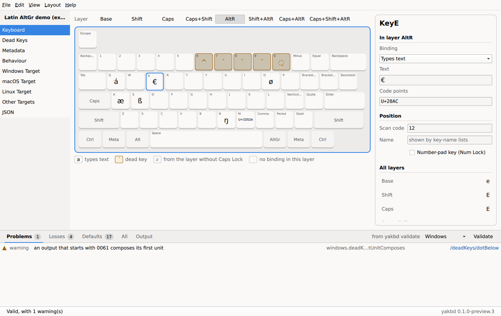

# YAKBD Editor

A desktop editor for keyboard layouts in [YAKBD](https://yakbd.github.io/)'s open `.kbl.json` format: see the layout
as a keyboard, layer by layer, change what each key types, edit dead keys and build choices, and build installable
layouts with the bundled [`yakbd`](https://github.com/yakbd/yakbd-cli) tool.

<picture>
  <source media="(prefers-color-scheme: dark)" srcset="docs/images/editor-dark.png">
  
</picture>

**Runs on** Windows (x64, ARM64), macOS (Apple silicon and Intel) and Linux (x86-64).
**Builds layouts for** Windows today; macOS and Linux (XKB, Wayland and X11) in the next release; Android, iOS,
ChromeOS and Keyman planned. Status: preview.

## Download

From the [latest release](https://github.com/yakbd/yakbd-gui/releases/latest):
[`yakbd-gui-setup.exe`](https://github.com/yakbd/yakbd-gui/releases/latest/download/yakbd-gui-setup.exe) for Windows,
the `.dmg` for macOS and the `.AppImage` for Linux (named `yakbd-gui.dmg` and `yakbd-gui-x86_64.AppImage` from the next
release on). Each one carries the `yakbd` tool.

## Documentation

- [Installing the editor](https://yakbd.github.io/editor/#install)
- [What the editor does](https://yakbd.github.io/editor/)
- [Building for Windows, macOS and Linux](https://github.com/yakbd/yakbd-gui/blob/main/docs/targets.md)
- [Building the editor from source](https://github.com/yakbd/yakbd-gui/blob/main/docs/building.md)
- [What is verified](https://yakbd.github.io/editor/verified)
- [What's new](https://github.com/yakbd/yakbd-gui/releases/latest)

## Licence

MIT-0, see [LICENSE](LICENSE). Qt is used under the LGPL v3; third-party material is listed in [NOTICE](NOTICE).
[Contributing](https://github.com/yakbd/.github/blob/main/CONTRIBUTING.md) ·
[Code signing policy](https://github.com/yakbd/yakbd-gui/blob/main/docs/code-signing-policy.md) (planned: free code signing provided by
[SignPath.io](https://about.signpath.io), certificate by [SignPath Foundation](https://signpath.org)).
